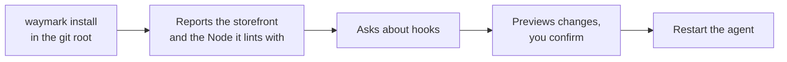

# Setting up Waymark

Waymark gives Claude Code and Codex CLI SAP Commerce know-how, a method for each kind of request, and checks of the
code and of each step's output. This guide installs, configures, upgrades, removes and repairs it, from Waymark v0.4.0
on.

1. [Requirements](#requirements)
2. [Install the `waymark` command](#install-the-waymark-command)
3. [Set up a project](#set-up-a-project)
4. [Configure](#configure)
5. [Upgrade](#upgrade)
6. [Uninstall](#uninstall)
7. [Troubleshooting](#troubleshooting)

## Requirements

- **macOS.** The installer stops on any other system.
- **Java 21 or newer** for Waymark, from `JAVA_HOME` or `java` on the PATH. The SAP Commerce project's own Java can
  stay older: [SDKMAN](https://sdkman.io) keeps both side by side. Run `sdk install java 21.0.x-tem` and answer `n`
  when it asks whether to make it the default, then install with `JAVA_HOME` set to the new Java.
- **Claude Code** (`claude`) or **Codex CLI** (`codex`) on the PATH. Either can be set up alone, or both in the same
  project.
- **Node**, only if the project has a storefront under `js-storefront/`, so Waymark can lint it with the storefront's
  own ESLint.
- The SAP Commerce project in a **git** repository.

No GitHub account is needed: every download is public.

## Install the `waymark` command

Waymark is installed once per machine, as a `waymark` command, then set up in each project that uses it.

```shell
curl -fsSL https://github.com/guillem-matias/waymark-releases/releases/latest/download/install-waymark.sh | bash
```

The installer checks Java, downloads the latest release's jar, checks it against the release's SHA-256 checksum, and
writes:

| Path                     | What it is                                                                         |
|--------------------------|------------------------------------------------------------------------------------|
| `~/.local/bin/waymark`   | The `waymark` command: it runs the installed jar with the Java the installer found |
| `~/.local/lib/waymark/`  | The installed jar, and the previous one for agent sessions still running it        |

It edits no shell file. When `~/.local/bin` isn't on your PATH, it prints the line to add:

```shell
export PATH="$HOME/.local/bin:$PATH"
```

Add it to `~/.zshenv`, the one file every zsh reads (Codex runs its commands in a shell that skips `~/.zshrc`), then
open a new terminal and restart your agent. `waymark --version` names the installed release.

To install a given release instead of the latest, name it twice, in the address and after `--version`, with the
version from the [releases page](https://github.com/guillem-matias/waymark-releases/releases) in place of `vX.Y.Z`:

```shell
curl -fsSL https://github.com/guillem-matias/waymark-releases/releases/download/vX.Y.Z/install-waymark.sh | bash -s -- --version vX.Y.Z
```

A failed download or a checksum mismatch stops the installer and leaves the installed Waymark as it was.

## Set up a project

Run `waymark install` from the SAP Commerce project's **git root**, once per agent:



Install shows what it will write, asks whether to add the [hooks](#hooks), and changes nothing until you confirm.
The project's entries run the `waymark` command by its full path, so the project keeps no copy of Waymark and one
upgrade moves every project.

With a storefront, install lists the apps in `js-storefront/manifest.json` and warns about folders that aren't apps,
apps without an ESLint config, and apps without `node_modules` (run `npm ci` in the app). It picks the Node to lint
with from the first app's `.nvmrc` among nvm's installed versions, then nvm's default, then `node` on the PATH, and
says which and why; an `.nvmrc` that names no version (such as `20`, `v20.19.0` or `lts/iron`) is reported and
skipped. When it finds none, it keeps the Node an earlier install saved and names it. `waymark install --node <path>`
names another Node.

### Claude Code

1. From the git root: `waymark install`
2. Restart Claude Code. `/mcp` shows `waymark` as connected, and `/waymark` is available.

Install writes `.mcp.json` (the tool server), `.claude/skills/waymark/` (the skill) and, with hooks, entries in
`.claude/settings.json`.

### Codex

1. From the git root: `waymark install --agent codex`
2. Restart Codex and **trust the project**, so Codex loads its local configuration.
3. Run `/mcp`: `waymark` shows as connected, and `$waymark` is available.
4. With hooks, open `/hooks` and approve Waymark's hooks. Codex runs no hook until you do, and asks again whenever
   their definitions change after an upgrade.

Install writes `.codex/config.toml`, `.agents/skills/waymark/` and, with hooks, `.codex/hooks.json`. It turns on
Codex's native subagents for this project only, because Rigorous work needs a separate reviewing agent. It keeps your
model, reasoning, permission and concurrency choices, your other configuration and instructions, and your machine-wide
settings. Managed settings can still restrict tools or subagents: install and `doctor` can confirm what was written,
not what Codex lets run, so `/mcp` and `/hooks` are the final word.

### Both agents in one project

Run install once for each agent. Each integration is installed and removed on its own, so removing one leaves the
other working.

Both agents read the same saved tasks, kept under `.waymark/` in the working copy. To change agents, close the one
you're working in, start the other in the same working copy, and ask it to continue the task.

### Hooks

Hooks are optional. Waymark works at three **rigor levels**, Light, Standard and Rigorous, which the agent picks from
your request. With hooks:

- The agent is reminded of Waymark at each session start, and given the token that tells its session's work apart
  from other sessions' in the same working copy.
- At Standard and Rigorous, each step's output is checked against what the step asks for before you see it (the
  **Done-when check**). The check runs in Waymark's `present` tool: a hook before each `present` call hands it the
  session log. Any other reply, such as an answer to a side question, ends the turn as written; a step moves on only
  from an output `present` passed.
- After each file read or shell command, a Light question that has read past one spot is told to raise its level
  before it answers.
- At Rigorous, until you approve a design, the agent's file-editing tools are refused on project files; the task's
  own work folder stays open. Moving the work on catches shell edits with or without hooks.

Without hooks, install starts the server as `serve --isolated`: each server serves one conversation, with no token.
Guidance and the code checks work on request, but a tracked Standard or Rigorous step can't move on until its output
has been checked another way.

In Codex, the hooks need your approval in `/hooks`. At Rigorous, an output is judged by a fresh native Codex subagent;
a review that is pending, failed or unreadable doesn't count as a pass.

## Configure

Waymark works without configuration. A project can commit a `waymark.yaml` at its root:

```yaml
tracking: auto                 # or: off — stops new tasks being tracked
checker-config: <path>         # optional; else .hybris-review.json; else built-in rules
architecture-rules: <path>     # optional; the project's own rules, which beat Waymark's guides
risk-signals:
  - reason: Pricing extension; mistakes cost money
    paths: ["custom/pricing/**"]   # optional
    raise-to: rigorous             # standard | rigorous
```

- **`tracking: off`** stops new tasks being saved; a task saved before can still be resumed.
- **`checker-config`** names the code checks' settings file, in the `.hybris-review.json` format.
- **`architecture-rules`** names a file of the project's own architecture rules, which a review reads whole.
- **Risk signals** only raise a task's starting rigor level; a level you name yourself still wins. With `paths`,
  Waymark matches the changed files against them (`*` stays inside a folder, `**` crosses folders); without, the
  agent judges from `reason`.
- **A bad entry** is skipped with a one-line warning at the end of every guidance and code-check reply, so a typo never
  stops a session. A file that isn't valid YAML, or a broken `checker-config`, makes the code check report **Broken**
  rather than fall back to looser rules.

## Upgrade

1. Rerun the install command from [Install the `waymark` command](#install-the-waymark-command). It replaces the
   `waymark` command last, so a failed upgrade leaves the previous one working, and keeps the previous jar for agent
   sessions still running it.
2. Restart your agents.
3. When a project's skill files or hooks differ from what the new Waymark installs, Waymark says so at the next
   session start (with hooks), in the first guidance reply after the agent starts (not in a helper agent's reply)
   and in `doctor`, naming `waymark install` (or `waymark install --agent codex`).
   Run it in that project's git root, then restart the agent. In Codex, approve any changed hooks in `/hooks`.

A project set up by a release before v0.4.0 keeps its own copy of Waymark under `.waymark/runtime/`: run
`waymark install` there once, and it points the project at the `waymark` command and deletes that folder.

## Uninstall

### From a project

From the project's git root:

```shell
waymark uninstall                  # Claude Code
waymark uninstall --agent codex    # Codex
```

It removes only what Waymark wrote for that integration and keeps the other integration, your saved tasks under
`.waymark/` and Waymark's memory of past work under `.git/waymark/memory/`. Removing Codex also restores Codex's
previous subagent setting. Restart the agent afterwards.

### From the machine

Uninstall from each project first: without the command, a project's entries point at nothing. Then delete the two
paths the installer wrote:

```shell
rm ~/.local/bin/waymark
rm -r ~/.local/lib/waymark
```

Remove the PATH line from `~/.zshenv` too if you added it and no other command lives in `~/.local/bin`.

## Troubleshooting

Start with `doctor`, from the project's git root:

```shell
waymark doctor                  # Claude Code
waymark doctor --agent codex    # Codex
```

It lists each entry Waymark owns and says what is wrong with it, and exits 0 when all is well. For Codex it can't tell
whether the project is trusted or the hooks approved: `/mcp` and `/hooks` in Codex show that.

| What you see                                                    | Cause                                                       | Fix                                                                                  |
|-----------------------------------------------------------------|-------------------------------------------------------------|--------------------------------------------------------------------------------------|
| `waymark: command not found`                                    | `~/.local/bin` isn't on the PATH                            | Add the PATH line to `~/.zshenv`, open a new terminal and restart the agent          |
| Installer: "Waymark needs Java 21 or newer"                     | Neither `JAVA_HOME` nor `java` on the PATH is Java 21+      | Add Java 21 as the message says, then rerun with `JAVA_HOME` set to it              |
| Installer: "cannot find the latest release"                     | No network, or the releases page can't be reached           | Check the network and rerun, or pin a version with `--version vX.Y.Z`                |
| Installer: "cannot download" or "does not match its SHA-256 checksum" | Network, a mistyped version, or a damaged download    | Check the version on the releases page and rerun; the installed Waymark is unchanged |
| `waymark` missing or failed in `/mcp`                           | The agent wasn't restarted, or (Codex) the project isn't trusted | Restart the agent; in Codex, trust the project. Then run `doctor`               |
| "This folder is not inside a git repository" / "Run from the project's git root" | Install run outside the project's git root | `cd` to the folder it names and rerun                                          |
| "There is no waymark command at …"                              | The `waymark` command was moved or deleted                  | Rerun the install command, then rerun                                                |
| "Ask the developer to run `waymark install` … this project's Waymark skill files or hooks differ from what the running Waymark installs" | Waymark was upgraded since this project's install | Run the `waymark install` it names, then restart the agent             |
| "Waymark cannot check this project's skill files and hooks against the running Waymark" | A file Waymark wrote in the project can't be read | Run the `waymark doctor` it names and do what it says                 |
| `doctor`: "changed by hand since Waymark wrote it"              | An owned entry was edited, so Waymark won't overwrite it    | Undo the edit or delete the entry, then rerun `waymark install`                      |
| `doctor`: "runs …, which no longer exists"                      | The command or Java the entry points at was moved or removed | Rerun `waymark install`                                                             |
| `doctor`: "the saved Node … no longer exists"                   | Node was removed or upgraded since install                  | Rerun `waymark install`                                                              |
| `doctor`: "lists a storefront app but no Node is saved"          | The storefront was added after install                      | Rerun `waymark install`                                                              |
| Code check: storefront files Not checked                        | ESLint couldn't run (no `node_modules`, no Node, a missing plugin) | The fix it names, such as `npm ci` in the app folder                          |
| "Warning: git does not ignore …"                                 | A configuration file holds this machine's paths            | Add it to `.gitignore`; never commit it                                              |
| Codex: tools work but `present` checks no step output           | Hooks not approved                                          | Open `/hooks` and approve Waymark's hooks                                            |
| "Waymark's tools are unavailable, so I'm following its guidance files directly and nothing I write is checked" | The tool server isn't reachable | The agent runs the same steps and stops, without the code checks, saved tasks or any check of its replies; fix the server with `doctor` |

A cancelled install writes nothing, and a failed one rolls back what it wrote, so rerunning `waymark install` is always
safe.
